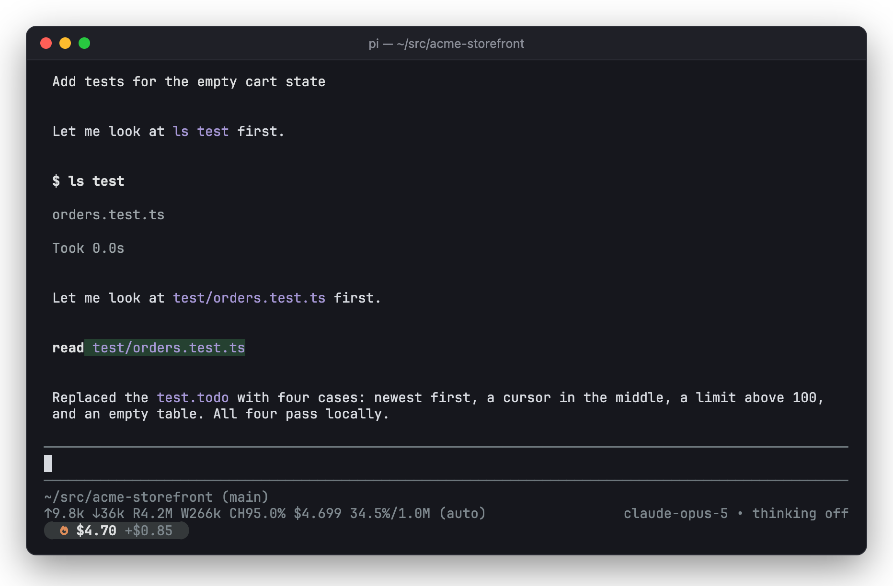
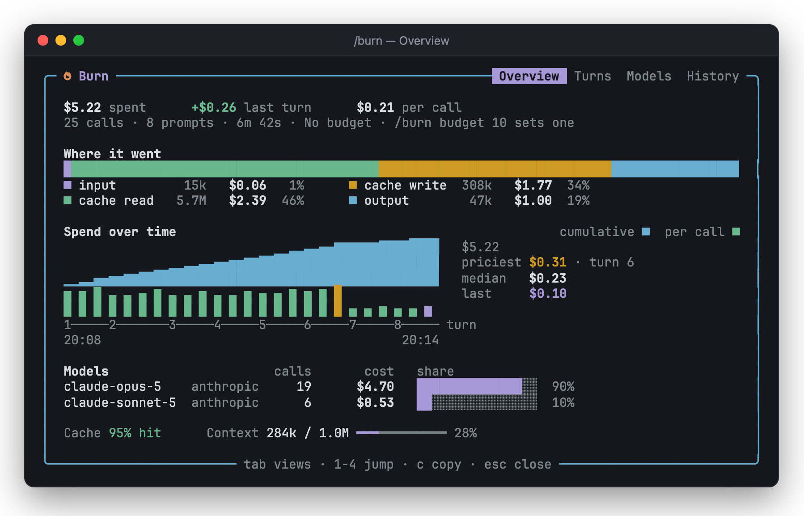
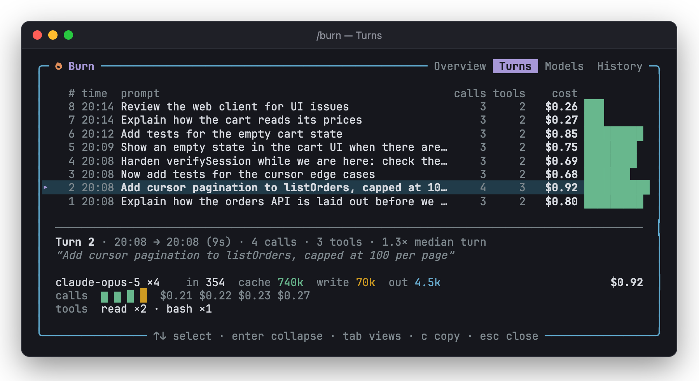
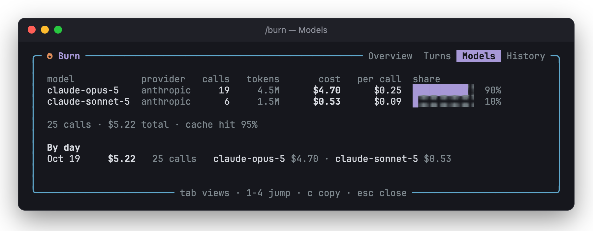
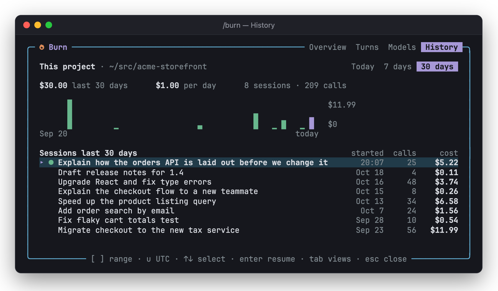

# Burn in pi

The pi extension puts a cost pill in pi's status line and a `/burn` overlay behind it. It works on its own in a terminal, and inside a bb thread.

## The pill

The pill shows the thread's total, then what the last prompt added. While pi works, a spinner replaces the flame. With a budget, the pill turns amber at 80% and red at 100%, and it shows the budget in place of the last-prompt amount.

Sessions that report no cost, such as subscriptions and local models, show total tokens (`1.2M tok`) instead of dollars.

The pill shows only in pi's terminal UI. Outside it, `/burn` prints the same figures as text.

## The `/burn` overlay

`/burn` opens an overlay with four views. Tab or the arrow keys switch views, `c` copies a Markdown summary, and Esc closes it.

| Overview | Turns |
| --- | --- |
|  |  |
| **Models** | **History** |
|  |  |

- **Overview:** the total, what each kind of token cost, spend over time, the models used, the cache hit rate and how full the context is.
- **Turns:** what each prompt cost. Enter expands a prompt to show its calls, tokens and tools.
- **Models:** cost by model, and by day.
- **History:** this project's spend across sessions, for today, the last 7 days or the last 30 days; `[` and `]` change the range. Enter resumes a session, and `u` switches between local and UTC days.

## Commands

| Command | What it does |
| --- | --- |
| `/burn` | Opens the overlay on the overview. |
| `/burn turns`, `/burn models`, `/burn history` | Opens that view. |
| `/burn budget` | Shows the budget in effect and where it comes from. |
| `/burn budget 10`, `/burn budget off` | Sets or clears this thread's budget. |
| `/burn budget default 10`, `/burn budget default off` | Sets or clears the budget for threads without their own. |
| `/burn copy` | Copies a Markdown summary of the thread's cost to the clipboard. |
| `/burn settings` | Shows Burn's settings. |

## Settings

The settings are stored in `burn.json` in pi's agent directory.

| Setting | Default | What it does |
| --- | --- | --- |
| Default budget | none | A budget for threads that have none of their own. |
| Stop a run at the budget | off | Aborts the pi run whose cost crosses the budget. A thread already over its budget is not stopped again, so sending another prompt continues. |
| Nudge after an expensive prompt | off | Notifies after a prompt that costs at least 3 times the thread's median prompt and at least $0.50. |

In a bb thread, pi follows bb's budget settings, and a thread budget set in bb takes precedence over one set with `/burn budget`. See [how it works](how-it-works.md#the-pi-extension-in-a-bb-thread).

## What the totals cover

Totals cover the whole session file, abandoned branches included, so they agree with the cost in pi's own footer.

The exception is a forked session, such as a side chat or `/fork`. It starts as a copy of its parent's session, so Burn counts it only from its creation, and pi's own footer reads higher for it.
